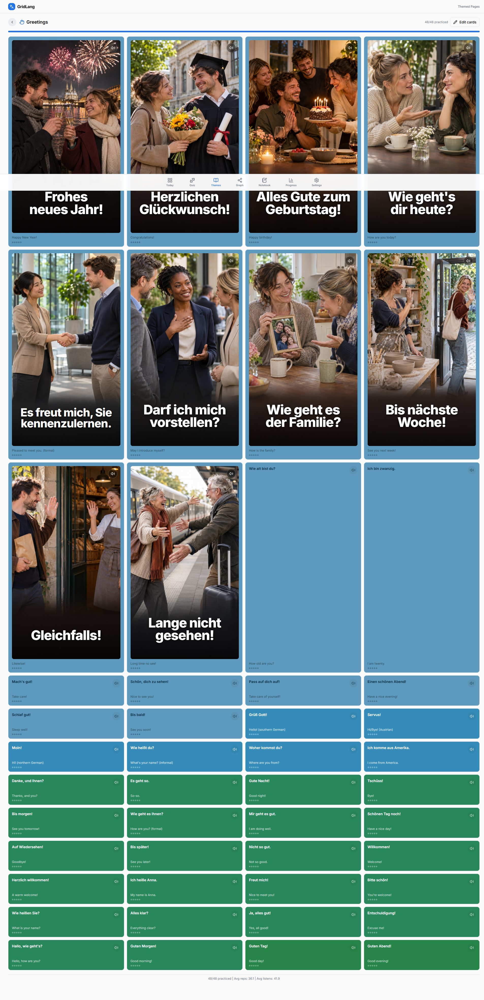
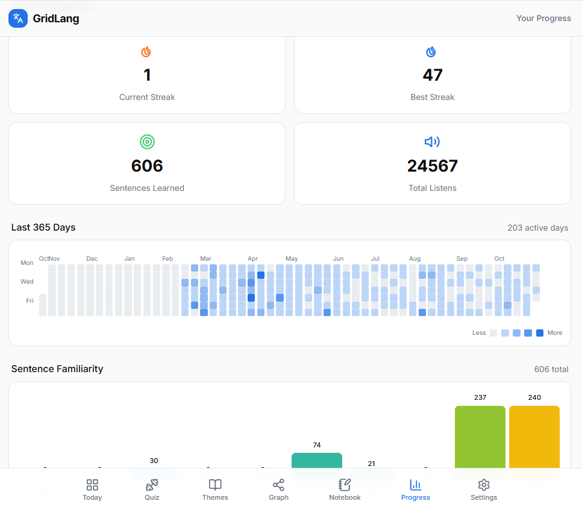

# GridLang

GridLang is a grid-based German sentence-learning app built around **atomic learning** and **spaced repetition**. Instead of studying isolated vocabulary lists, learners work with complete, practical sentences in small, repeatable sessions. Each sentence has its German text, English translation, and phonetic transcription, with audio pronunciation powered by the browser's speech synthesis API.

**Live app:** [https://v0-grid-lang-pwa.vercel.app/](https://v0-grid-lang-pwa.vercel.app/)




## What it does

GridLang turns German sentence practice into a manageable daily routine. Its core experience is a configurable grid of sentence cards: open a sentence, read and listen to it, then mark it as practiced. A spaced-repetition scheduler tracks review intervals and brings due sentences back into the daily queue.

### Features

- **Daily practice grid** — Review a focused selection of new and due sentences. Configure the grid size to fit your session.
- **Themed sentence library** — Explore 240+ German sentences across 10 everyday topics, including greetings, food, travel, and work.
- **Spaced repetition** — Track practice history, repetition counts, review dates, and learning intervals for each sentence.
- **Pronunciation practice** — Listen to German text using the Web Speech API, adjust playback speed, and optionally enable auto-play.
- **Interactive quizzes** — Practice with five question formats: German-to-English multiple choice, English-to-German multiple choice, listening, word-bank sentence building, and typed answers. Sessions include XP, combo bonuses, and a limited-heart mechanic.
- **Sentence graph** — Explore relationships between sentences, create labeled connections, and add your own sentences.
- **Learning notebook** — Keep date-based notes and attach images or videos to learning entries.
- **Progress tracking** — Review practice streaks, activity history, and learning progress over time.
- **Personal settings and backups** — Customize the grid and audio settings, and export or import learning data as JSON.
- **Responsive PWA experience** — Use the app on desktop or mobile, with a web app manifest and app-oriented layout.

## Who it's for

GridLang is designed for:

- **German beginners and independent learners** who want to build practical sentence familiarity through short, consistent sessions.
- **Visual and structured learners** who prefer organizing material into grids, themes, and connected concepts.
- **Learners who benefit from repetition** and want a review queue that adapts to their practice history.
- **Self-directed learners** who want to track progress, add personal sentences, and keep notes in one place.

The included sentence library provides a starting point; the graph and custom-sentence features let learners extend it with material relevant to their own goals.

## What it's built with

| Layer | Technologies | Purpose |
| --- | --- | --- |
| Framework | [Next.js 16](https://nextjs.org/) (App Router) | Application structure, routing, and development/build tooling |
| UI | [React 19](https://react.dev/), [TypeScript](https://www.typescriptlang.org/) | Component-based interface and typed application logic |
| Styling | [Tailwind CSS](https://tailwindcss.com/), [Radix UI](https://www.radix-ui.com/) | Responsive styling and accessible UI primitives |
| Visualization | [Cytoscape.js](https://js.cytoscape.org/) | Interactive sentence relationship graph |
| Local data | [Dexie.js](https://dexie.org/) / IndexedDB | Persistent browser-side learning data |
| Charts and UI utilities | Recharts, Lucide, date-fns | Data visualization, icons, and date utilities |
| Audio | Web Speech API | German text-to-speech pronunciation |
| Testing | [Vitest](https://vitest.dev/), [Playwright](https://playwright.dev/) | Unit and browser integration tests |
| Package manager | [pnpm](https://pnpm.io/) | Dependency installation and project scripts |

### Data storage

The app uses **IndexedDB through Dexie.js** as its local persistence layer. Learning progress, settings, activity, custom sentences, graph connections, notebook entries, and quiz statistics are stored in the browser.

The repository also contains Firebase/Firestore integration code. The standard local setup does not require Firebase credentials.

## How to run it

### Prerequisites

- [Node.js](https://nodejs.org/) 20.9 or later
- [pnpm](https://pnpm.io/) 10.34.7 (the version declared by this project)

### 1. Clone the repository

```bash
git clone https://github.com/wendychen/grid-lang.git
cd grid-lang
```

### 2. Install dependencies

```bash
corepack enable
pnpm install
```

### 3. Start the development server

```bash
pnpm dev
```

Open [http://localhost:3000](http://localhost:3000) in your browser.

### 4. Create a production build (optional)

```bash
pnpm build
pnpm start
```

The production server runs at [http://localhost:3000](http://localhost:3000).

## Tests

Run the unit tests:

```bash
pnpm test:unit
```

Run the browser integration tests:

```bash
pnpm test:integration
```

Run both test suites:

```bash
pnpm test
```

## License

This project is licensed under the [MIT License](LICENSE).
